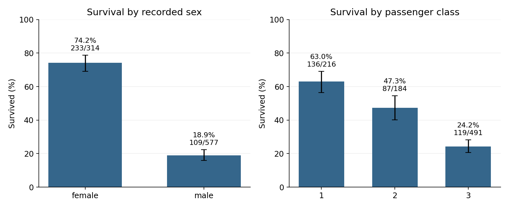

# Data Science with Python Internship

A five-week internship workspace built around the **Titanic passenger dataset**. Weeks 1–5 cover data preparation, visual storytelling, statistical hypothesis testing, machine learning and strategic reporting. The repository brings together the Word reports, executable analysis, source data and generated results.

**Programme:** YuvaIntern Virtual Data Science with Python Apprenticeship  
**Data snapshot:** 891 passenger records, 342 survivors, 15 original columns  
**Tested runtime:** Python 3.12.14

## Weekly work

| Week | Topic | Status | Main files |
|---|---|---|---|
| 1 | Acquisition, cleaning and exploratory analysis | Original report included; reconstructed code executed | [Report](weeks/week01/Week1_Data_Acquisition_Cleaning_EDA.docx) · [Code](weeks/week01/analysis.py) · [Outputs](weeks/week01/outputs) |
| 2 | Advanced visualisation and storytelling | Original report included; reconstructed code executed | [Report](weeks/week02/Week2_Data_Visualization_Storytelling.docx) · [Code](weeks/week02/analysis.py) · [Outputs](weeks/week02/outputs) |
| 3 | Statistical analysis and hypothesis testing | Report and analysis completed | [Report](weeks/week03/Week3_Statistical_Analysis_Hypothesis_Testing.docx) · [Code](weeks/week03/analysis.py) · [Outputs](weeks/week03/outputs) |
| 4 | Machine learning development and evaluation | Report and analysis completed | [Report](weeks/week04/Week4_Machine_Learning_Development_Evaluation.docx) · [Code](weeks/week04/analysis.py) · [Outputs](weeks/week04/outputs) |
| 5 | Project reporting and strategic recommendations | Report and synthesis completed | [Report](weeks/week05/Week5_Comprehensive_Project_Report.docx) · [Code](weeks/week05/analysis.py) · [Outputs](weeks/week05/outputs) |


## Quick start

Extract the archive and open a terminal inside `internship-data-science`. Use Python 3.12 for the pinned environment.

**Windows PowerShell**

```powershell
py -3.12 -m venv .venv
.venv\Scripts\python.exe -m pip install -r requirements.txt
.venv\Scripts\python.exe run_all.py
.venv\Scripts\python.exe -m unittest discover -s tests -v
```

**Linux, macOS or WSL**

```bash
python3.12 -m venv .venv
.venv/bin/python -m pip install -r requirements.txt
.venv/bin/python run_all.py
.venv/bin/python -m unittest discover -s tests -v
```

No API key is required. The exact source CSV is included, so analysis runs offline after dependencies are installed. If the CSV is removed, the loader downloads it and checks its SHA256 before accepting it. A changed upstream snapshot requires explicit review rather than silently changing the results.

To run a single week, use the virtual environment's Python with its script, for example:

```bash
python weeks/week03/analysis.py
```

Replace `python` with `.venv/bin/python` or `.venv\Scripts\python.exe` if the virtual environment is not activated. Scripts resolve paths relative to their own locations, so they do not depend on the terminal's working directory.

## Repository contents

- `data/raw/titanic.csv`: exact source snapshot, never modified by analysis.
- `data/processed/titanic_eda.csv`: generated EDA table with imputed age and preserved original-age fields.
- `src/titanic_data.py`: shared loading, hash validation and EDA preprocessing.
- `weeks/week01/`: original Word report, reconstructed EDA script and five figures.
- `weeks/week02/`: original Word report, reconstructed storytelling script, six figures and summary tables.
- `weeks/week03/`: Week 3 Word report, executed statistical script, four figures and machine-readable results.
- `weeks/week04/`: model development, test predictions, split manifest and evaluation figures.
- `weeks/week05/`: integrated project report, synthesis and recommendations.
- `docs/analysis_notes.md`: corrections, definitions and interpretation limits.
- `docs/data_provenance.md`: source, snapshot hash and reuse information.
- `docs/github_setup.md`: instructions for uploading this project to GitHub.
- `tests/test_results.py`: dataset and statistical-result regression checks.
- `.github/workflows/analysis.yml`: reruns the analysis and checks on pushes and pull requests.

Generated CSVs, figures and result JSON files are intentionally tracked so a reviewer can inspect the work without running Python. `run_all.py` regenerates those outputs. It does **not** rewrite the submitted Word reports.

## Selected findings



The Week 3 analysis found clear associations of survival with sex, passenger class and family size. The mean-age difference was small and sensitive to missing-value treatment. These are observational associations, not causal estimates.

| Week 3 test | Records | Holm-adjusted p-value | Interpretation under working assumptions |
|---|---:|---:|---|
| Sex and survival | 891 | 1.856e-58 | Evidence of association |
| Class and survival | 891 | 1.820e-22 | Evidence of association |
| Mean age by survival | 714 | 0.04119 | Small difference; sensitive to missingness |
| Under 13 status and survival | 714 | 0.004025 | Evidence of association |
| Family group and survival | 891 | 1.957e-16 | Evidence of association; within-family dependence matters |

The five-test family uses a significance threshold of 0.05 and Holm adjustment. The questions were informed by earlier exploration of the same data, so this remains exploratory work. Full-precision results, expected-cell checks and effect sizes are in [results.json](weeks/week03/outputs/results.json).

## Continuity and corrections

Weeks 1 and 2 were supplied as Word reports, without their original Python source files. Their scripts here are newly reconstructed implementations. They preserve the project themes while correcting identified issues. The original reports are retained unchanged as historical submissions, so some claims in them differ from the audited code and Week 3 report.

In particular, all 891 passenger records are retained; 107 repeated feature profiles do not establish duplicate people. Formal age tests use observed ages. The family-size pattern is non-linear and is an inverted U when grouped as solo, 2–4 and 5 or more. Class-only adjustment does not eliminate the port association in the specified Week 3 model. See [analysis notes](docs/analysis_notes.md) before interpreting the earlier reports.

## GitHub repository

Repository: https://github.com/24f2001637/yuva-intern-Data-Science-with-Python-internship

Clone this project with:

```bash
git clone https://github.com/24f2001637/yuva-intern-Data-Science-with-Python-internship.git
cd yuva-intern-Data-Science-with-Python-internship
```

Then follow the environment setup above. All five internship weeks are complete. The GitHub Actions workflow reruns the analysis and checks on pushes and pull requests.

## Sources and reuse

The Titanic CSV comes from the [Seaborn example-data repository](https://github.com/mwaskom/seaborn-data). Method references and the data hash are recorded in [data provenance](docs/data_provenance.md). No new license is assigned to the upstream dataset or the supplied reports. Choose an appropriate license for your own code before licensing the repository as a whole.


## Machine learning and project synthesis

Week 4 compares a majority baseline, logistic regression and a constrained decision tree.
Selection uses five-fold ROC AUC on 712 development records (seed 42); the 179-record
test split is used for final reporting, at a fixed 0.50 threshold. Logistic regression
was selected: accuracy 0.8212, ROC AUC 0.8452, precision 0.8136, recall 0.6957 and
F1 0.7500. The confusion matrix is [[99, 11], [21, 48]].

Preprocessing is fitted within each training fold. The outcome-equivalent `alive`
column is excluded. The earlier project explored the full dataset, so this is an
internal benchmark, not pristine external validation. Related passengers may cross
splits. Survivor recall in this split is 45/45 for women and 3/24 for men; aggregate
accuracy should not be presented without these error limitations.

Week 5 synthesizes the measured results and proposes data-quality, validation and
research actions. No causal effect, operational deployment or financial benefit
has been established. Its source script does not retrain models.

To rebuild the two new Word reports after running analysis:

```bash
python build_remaining_reports.py
```

This uses the approved Week 3 report as the design template. Render and inspect the
documents in a Word-compatible application before submission. The original Week 1
and Week 2 reports remain unchanged.
